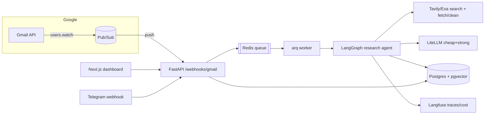
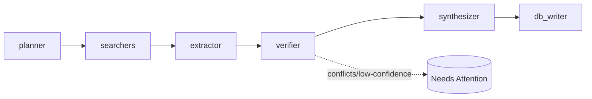

# RecruitSage — AI Company Intelligence

Turns your recruitment inbox into a **provenance-tracked company intelligence workspace**:
detect companies from Gmail → research them with a verifying agent → chat over the results
with citations → get Telegram alerts. Every displayed fact traces to a source; unverified
data is labelled, never fabricated.

> **Migration in progress.** Two stacks live in this repo:
> - **`/` (root)** — the current, working Node.js + Express + MongoDB app (Gmail ingestion,
>   research, dashboard, Telegram). Runs today via `npm run dev`.
> - **`/apps` + `/infra`** — the v2 target (Next.js + FastAPI + Postgres/pgvector). Scaffolded;
>   brought up with `docker compose up`. The root app stays until v2 reaches parity.

## Architecture (v2)



### Research agent graph



## Data model (provenance-first)
`users, companies, company_aliases, emails, applications, research_runs, sources, facts
(company_id, field, value, source_id, confidence, status), hiring_stages, interview_topics,
chunks (pgvector), chat_sessions, chat_messages, llm_calls, eval_runs`.
Rules: every fact → a source; conflicts kept with a `conflicting` badge; `hq_location` and
`role_location` are **separate**; facts older than 30 days are marked stale and re-researched.

## Run locally (v2)
```bash
cp apps/api/.env.example apps/api/.env   # fill keys
cp apps/web/.env.example apps/web/.env
docker compose up --build
# web http://localhost:3000 · api http://localhost:8000/health
```

## Gmail without localhost
OAuth2 `gmail.readonly` + `users.watch` + Pub/Sub push → `/webhooks/gmail`, processed
incrementally via `history.list`. Watch renewed daily (expires after 7 days); 10-min poll
fallback. Processing is idempotent on `messageId`.
**Publish the OAuth consent screen** — apps in "Testing" get refresh tokens that expire after 7 days.

## Status
- ✅ Phase 1 (in root app): data-bug fixes + field-level provenance. See `git log`.
- 🚧 Phase 2 (this scaffold): monorepo, provenance schema, LangGraph skeleton, docker-compose, CI.
- ⏳ Phases 3–7: RAG chat + tools, UI (globe/graph/motion), evals + cost dashboard, resume/mock/MCP, polish.

See `docs/adr/` for decisions (model routing, hybrid retrieval, Gmail push vs poll).
